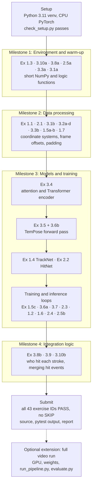
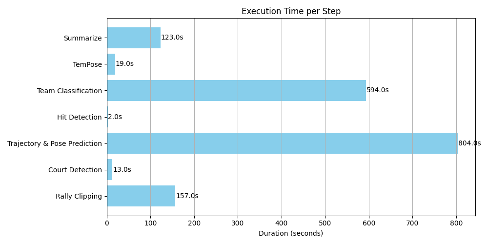

# capstone_bcclab

Badminton AI end-to-end student exercises

This system watches a broadcast badminton match and reports who hit each stroke, which
stroke it was, and when. We removed key parts of the code and put `TODO [Ex X.Y]` blocks
in their place. Your job is to write those parts again.

Every TODO block looks like this and ends with `raise NotImplementedError`:

```python
# ============================== TODO [Ex 1.1] ==============================
# What to implement, expected shapes, hints ...
# ===========================================================================
raise NotImplementedError("TODO [Ex 1.1]")
```

Delete the `raise` line after you write your solution. To list the remaining work, run:

```bash
grep -rn "TODO \[Ex" --include=*.py .
```

## Get the student framework

```bash
git clone https://github.com/frankxaio/capstone_bcclab.git
cd capstone_bcclab
```

This repository includes the 43 exercises, tests, fixtures, assignment, and grading
rubric. Model weights and match videos are obtained separately for the optional
video extension. Start with the CPU exercises below.

## Start with the CPU exercises

This track needs Python 3.11. It does not need a GPU, a video, model downloads, or the
court detector. On Ubuntu, run these commands from the repository root:

```bash
python3.11 -m venv .venv
source .venv/bin/activate
python -m pip install --upgrade pip
python -m pip install torch==2.1.0 --index-url https://download.pytorch.org/whl/cpu
python -m pip install -r requirements-exercises.txt
python scripts/check_setup.py
python -m pytest
```

On Windows, create the environment with `py -3.11 -m venv .venv`. Activate it in
PowerShell with `.venv\Scripts\Activate.ps1`, then run the same pip commands. If
`py -3.11` fails, install Python 3.11 first.

The setup check must pass. The exercise tests then fail on purpose, because every
exercise still raises `NotImplementedError`. Expect 41 exercise IDs marked TODO and 2
marked BLOCKED. The infrastructure tests should pass. When you finish all the exercises,
every test should pass with no skips. The total number of tests can grow if we add
infrastructure tests.

Instructors can run `python scripts/check_starter.py` to confirm that every failure is
an intentional TODO.

Read [the assignment](docs/ASSIGNMENT.md) for milestones, what to submit, and grading.
The full video pipeline is an optional extension with its own [setup guide](docs/PIPELINE.md).
[Student packaging](docs/RELEASE.md) explains how to build a lightweight classroom ZIP.
[Release validation](docs/VALIDATION.md) lists the tested environments and the parts of the pipeline that are still untested.

## Roadmap

The required track follows the four milestones in [the assignment](docs/ASSIGNMENT.md#required-milestones).
Inside each milestone, work in the [suggested order](#suggested-order). Check each step with
`pytest --ex <id>` before you move on.



## The pipeline

The exercises follow the three stages of the system. `main.py` runs them as steps 1 to 7.

```
Match video
 ├─ Process I, perception: rally clips, court, shuttle trajectory, player poses
 ├─ Process II, temporal slicing: hit frames, then stroke windows of poses, positions and shuttle
 └─ Process III, semantics and identity: stroke type from TemPose, and which player hit it
```

## Repository layout

```
main.py              Pipeline entry point, steps 1 to 7 (Ex 3.9)
utils.py             Shared helpers (Ex 1.3, 3.10)
rally_clipping/      Rally detection (Ex 1.1, 1.2)
TrackNetV3/          Shuttle tracking (Ex 1.4 to 1.6)
MMPose/              Player pose filtering (Ex 1.7, 3.2d)
HitNet/              Hit detection (Ex 2.1 to 2.4)
TemPose/             Stroke classification (Ex 2.5, 3.1 to 3.7)
team_classifier/     Player identity (Ex 3.8)
court_detection/     Court detector source and Python runner
ai_badminton/        Pose and trajectory readers adapted from MonoTrack
data/                Match labels and videos for the full-video run (see data/README.md)
docs/                Assignment, pipeline guide, and images
scripts/             Setup checks, weight download, pipeline runner, and evaluation
tests/               Exercise and infrastructure tests
```

---

## Process I: perception

| Ex | File | What you implement |
|----|------|--------------------|
| 1.1 | `rally_clipping/get_result.py` | `determine_cut_points`, a rising- and falling-edge detector that turns per-frame "court view" probabilities into rally start and end frames |
| 1.2 | `rally_clipping/img_predict.py` | `infer`, which runs the ResNet-18 court-view classifier and collects sigmoid probabilities |
| 1.3 | `utils.py` | `check_court_coordinates`, which rejects implausible court-corner detections |
| 1.4a-c | `TrackNetV3/model.py` | CBAM channel and spatial attention, and the U-Net `TrackNetV2.forward` with attention-weighted skip connections |
| 1.5a-c | `TrackNetV3/utils.py` | Frame stacking for the model input, conversion of a heatmap to the shuttle centre, and a weighted BCE loss |
| 1.6a-b | `TrackNetV3/predict.py` | Inference that thresholds heatmaps and rescales coordinates to the video resolution |
| 1.7a-c | `MMPose/detect_pose.py` | Filtering out non-players with the court polygon, and splitting players into top and bottom |

For background on TrackNetV3 and rally clipping, see the [reading list](docs/ASSIGNMENT.md#reading).

## Process II: temporal slicing

| Ex | File | What you implement |
|----|------|--------------------|
| 2.1a-c | `HitNet/data_preparation.py` | Label smoothing, edge-padded 7-frame windows, and per-frame feature vectors |
| 2.2 | `HitNet/hitnet.py` | `HitNet.forward`, which applies Conv1D, a bidirectional GRU, self-attention, max and average pooling, and an MLP, in that order |
| 2.3 | `HitNet/train.py` | One training step, with and without automatic mixed precision |
| 2.4a-b | `HitNet/predict.py` | Thresholding hit probabilities, and writing `clip_X_hits.csv` with absolute frame numbers |
| 2.5a-b | `TemPose/predict_by_hit.py` | Cutting a fixed window around each hit, and reshaping the inputs for TemPose |

For MonoTrack and related papers, see the [reading list](docs/ASSIGNMENT.md#reading).

## Process III: semantics and identity

| Ex | File | What you implement |
|----|------|--------------------|
| 3.1a-b | `TemPose/utils.py` | Homography projection from camera to court coordinates |
| 3.2a-b | `TemPose/utils.py` | Joint normalisation by bounding box, and position normalisation by court borders |
| 3.2c-d | `TemPose/prepare_train.py`, `MMPose/detect_pose.py` | The same normalisations in the training-data script, which uses different array layouts |
| 3.3a-b | `TemPose/generate_npy.py` | Bone vectors, and the combined joints and bones tensor |
| 3.4a-b | `TemPose/NN_models.py` | Multi-head self-attention with masking, and a pre-norm Transformer encoder |
| 3.5a-b | `TemPose/TemPoseII.py` | The TemPose forward pass, which runs a temporal transformer on each stream with a padding mask, then an interaction transformer |
| 3.6a-b | `TemPose/utility_tempose.py` | A learning-rate schedule with warm-up and cosine decay, and a sine-cosine positional embedding |
| 3.7 | `TemPose/train.py` | The loss and back-propagation step |
| 3.8a-b | `team_classifier/sport_player_team_classifier.py` | An ROI overlap test, and `select_player_boxes`, which keeps the YOLO boxes that are confident, on court, and large enough |
| 3.9 | `main.py` | Deciding which player hit each stroke, from the stroke prefix or from the box nearest the shuttle |
| 3.10a-b | `utils.py` | Ball-to-box distance, and merging neighbouring hit events |

For the TemPose paper, see the [reading list](docs/ASSIGNMENT.md#reading).

---

## Suggested order

Start with the warm-up group. Those exercises are short NumPy and logic functions.

1. Warm-up: 1.3, 3.10a, 3.8a, 2.5a, 3.3a, 3.1a
2. Data processing: 1.1, 2.1, 3.1b, 3.2a-d, 3.3b, 1.5a-b, 1.7
3. Models: 3.4, then 3.5 together with 3.6b, then 1.4 and 2.2
4. Training and inference loops: 1.5c, 3.6a, 3.7, 2.3, 1.2, 1.6, 2.4, 2.5b
5. Integration: 3.8b, 3.9, 3.10b, then the optional [full video run](#full-video-integration)

## Checking your work

Every exercise has tests in `tests/`. Run them from the repository root:

```bash
pytest                      # all exercises
pytest --ex 1.4             # only Ex 1.4a, 1.4b and 1.4c
pytest --ex 2 --ex 3.1a     # all of Process II, plus Ex 3.1a
pytest --ex 3.5a -vv        # one exercise, with the full error messages
```

Each run ends with a table that gives the status of every exercise:

```
=============================== Exercise results ===============================
  Ex 1.3    PASS     7/7 tests passed
  Ex 1.4c   FAIL     0/1 tests passed
  Ex 1.6b   BLOCKED  0/1 tests passed  - implement Ex 1.6a first
  Ex 2.1a   SKIP     0/3 tests passed  - needs skimage (not installed)
  Ex 3.4a   TODO     0/2 tests passed  - not implemented yet

  1 fail, 1 todo, 1 blocked, 1 skip, 1 pass (exercises)
```

| Status | Meaning |
|--------|---------|
| `PASS` | Your code gives the same results as the reference solution. |
| `FAIL` | Your code runs, but the result is wrong. Scroll up to the error message. |
| `TODO` | The exercise's `raise NotImplementedError` is still there. |
| `BLOCKED` | The test needs another exercise that you have not implemented yet. The table names it. |
| `SKIP` | A package this test needs is not installed. The table names the package. |

Notes on the tests:

- The tests run on the CPU in a few seconds. They need no GPU, video, or model weights.
  They fill each model with fixed, deterministic weights and compare its output with
  reference results stored in `tests/fixtures/`. Do not edit those files.
- For the model exercises 1.4c, 2.2, and 3.5a, a failing test names the first layer whose
  input has the wrong shape or values. For example, it may report that "the input of
  `up_block_2` has different values".
- Do not rename or remove the layers defined in `__init__`. The tests and the pretrained
  weights rely on the parameter names.
- The tests need only `numpy`, `pandas`, `torch`, `opencv-python`, `einops`,
  `scikit-image`, `scikit-learn`, `PyYAML`, and `tqdm`. When heavy pipeline packages such
  as `mmpose`, `ultralytics`, `supervision`, and `moviepy` are missing, the tests replace
  them with stubs.
- Most TODOs give the expected input and output shapes. Print the shapes while you work
  and compare them with the TODO.

---

## Full video integration

After you finish the exercises, follow the [pipeline guide](docs/PIPELINE.md). It covers
model downloads, building the court detector on Ubuntu, and this command:

```bash
python scripts/run_pipeline.py /path/to/match.mp4
```

The pipeline writes intermediate files to `videos/<video-stem>/`. It writes the final CSVs
and the annotated video to `results/<video-stem>/`. The [court detection guide](court_detection/README.md)
explains how to run the detector on Ubuntu and how to supply court coordinates with `--court-file`.

### Sample match

Download the eight labelled match videos from the [class Google Drive folder](https://drive.google.com/drive/folders/1YFi0mZLx8A9gnoQQ49Wjc4EhjQBkuWDb?usp=drive_link).
[Match data](data/README.md) lists the filenames and explains where to put them. Start with `full_1`, An Se Young vs Pornpawee
Chochuwong at the 2021 TOYOTA Thailand Open:

```bash
python scripts/run_pipeline.py data/videos/full_1.mp4
python scripts/evaluate.py full_1
```

The original project reported a run time of about 30 minutes for a 20-minute video.
Your run time depends on your hardware and the video length.



## License notice

This project includes code adapted from Adobe's [monotrack](https://github.com/jhwang7628/monotrack)
repository under the Adobe Research License. That license allows only noncommercial research
and teaching. The [Adobe notice](ai_badminton/LICENCE.txt) is included. The native court
detector has its own [BSD notice](court_detection/LICENSE), and TemPose keeps its
[license](TemPose/LICENSE). The original project license is in [LICENSE](LICENSE).
