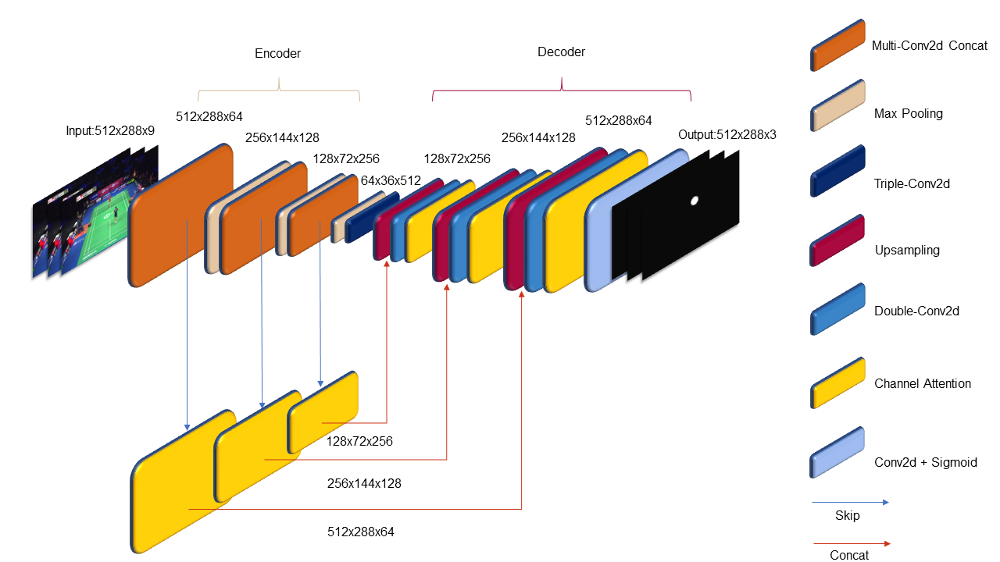
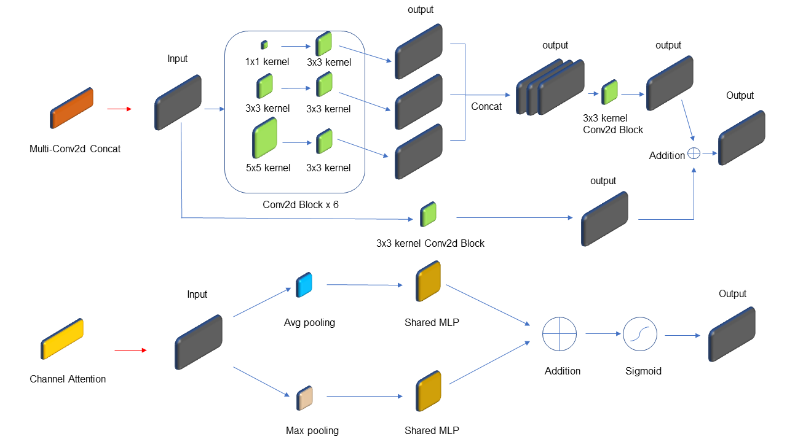

# TrackNetV3

TrackNet tracks the shuttlecock by predicting a heatmap for each input frame. This
folder holds the TrackNetV3 variant by [alenzenx](https://github.com/alenzenx/TracknetV3),
which adds attention to the TrackNetV2 U-Net. The class in `model.py` keeps the name
`TrackNetV2` so the pretrained weights still load.

## Architecture

The encoder uses multi-kernel convolution blocks (`Double2DConv2`) and max pooling. The
bottleneck is a triple convolution block. The decoder upsamples and concatenates the
encoder features through skip connections. A `CBAM` module re-weights each skip
connection and the output of each decoder block. In this repository, `CBAM.forward`
applies only channel attention. The spatial attention module exists, but the forward
pass does not use it, matching the pretrained weights. You implement the attention
modules and the forward pass in Ex 1.4.

## Reported accuracy

The upstream authors trained TrackNetV2 and TrackNetV3 on the same small dataset: 32,421
training images, 3,717 validation images, and 11,118 test images. They report an accuracy
of 90.53% for TrackNetV3 and 88.49% for TrackNetV2.

- [Training data](https://github.com/alenzenx/TrackNetV3/tree/main/raw_data) and
  [test data](https://github.com/alenzenx/TrackNetV3/tree/main/raw_data2)
- [TrackNetV3 paper](https://drive.google.com/file/d/1XIxRfKbLY684eixlc16gohjbg_JQsI7s/view?usp=sharing)
- [Upstream model.py](https://github.com/alenzenx/TrackNetV3/blob/main/model.py)

Upstream dataset labeling, conversion, and training tools are not included in this
course package. This repository uses TrackNetV3 only for inference, with the pinned
checkpoint from `scripts/fetch_weights.py`.

## References

[TrackNetV3](https://github.com/alenzenx/TracknetV3) builds on the original
[TrackNetV2](https://github.com/wolfyeva/TrackNetV2) and the ResNet-based
[TrackNet-Badminton-Tracking-tensorflow2](https://github.com/Chang-Chia-Chi/TrackNet-Badminton-Tracking-tensorflow2).
